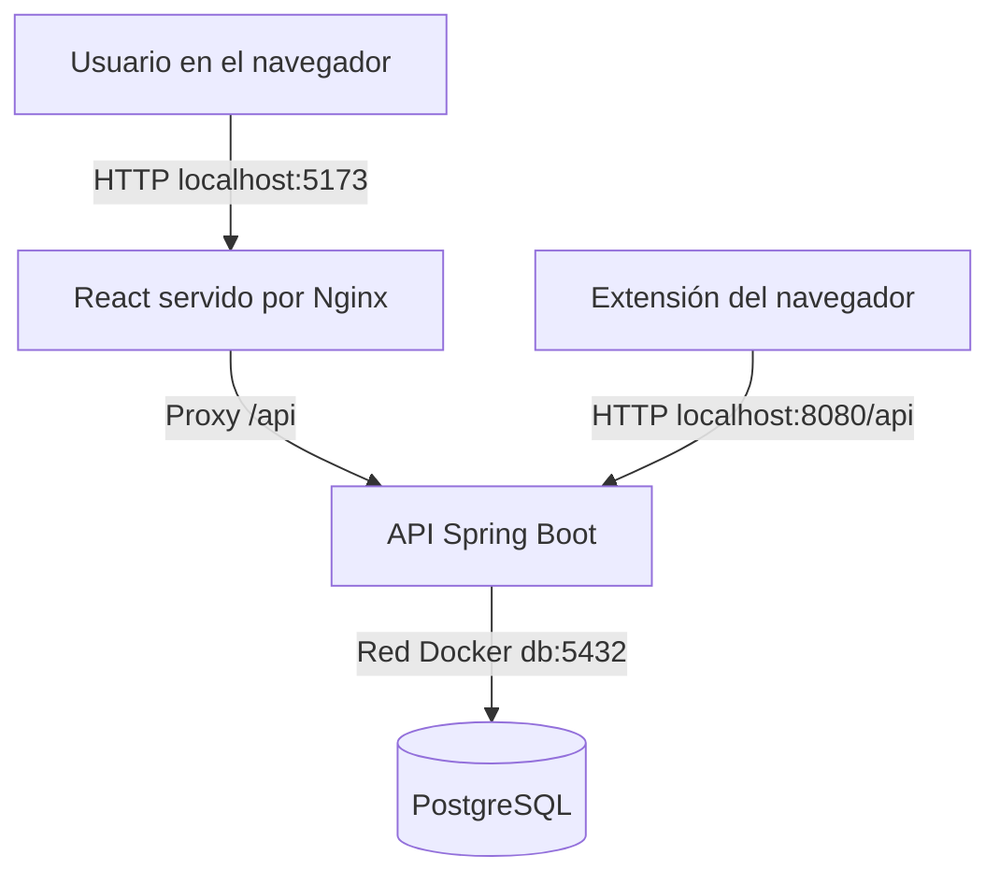

# MarketLens

**Sistema de análisis de riesgo y detección de posibles estafas en marketplaces.**

MarketLens es un prototipo académico que permite registrar y analizar publicaciones de comercio electrónico, observar indicadores de riesgo relacionados con los vendedores y los anuncios, consultar estadísticas y realizar reportes. Incluye una aplicación web, una API REST y una extensión experimental para el navegador.

> **Alcance:** los puntajes son indicadores orientativos basados en la información disponible; **no demuestran que una publicación o un vendedor sean fraudulentos**. La ausencia de datos no equivale a ausencia de riesgo. El proyecto es una demostración académica y no un servicio de verificación comercial.

## Contenido

- [Tecnologías y arquitectura](#tecnologías-y-arquitectura)
- [Requisitos](#requisitos)
- [Inicio rápido en Windows](#inicio-rápido-en-windows)
- [Inicio en Linux o macOS](#inicio-en-linux-o-macos)
- [Registro y recorrido de la aplicación](#registro-y-recorrido-de-la-aplicación)
- [Extensión de navegador](#extensión-de-navegador)
- [Comandos útiles de Docker](#comandos-útiles-de-docker)
- [Desarrollo y pruebas](#desarrollo-y-pruebas)
- [Configuración y seguridad](#configuración-y-seguridad)
- [Problemas frecuentes](#problemas-frecuentes)
- [Estructura del proyecto](#estructura-del-proyecto)

## Tecnologías y arquitectura

| Componente | Tecnologías |
| --- | --- |
| Backend | Java 21, Spring Boot 4, Spring Security, Spring Data JPA, Maven |
| Autenticación | JWT y contraseñas protegidas mediante BCrypt |
| Persistencia | PostgreSQL 17, Flyway (19 migraciones SQL) |
| Frontend | React, TypeScript y Vite |
| Publicación del frontend | Nginx, con proxy de las rutas `/api` |
| Extensión experimental | JavaScript y WebExtensions (Manifest V3) |
| Ejecución reproducible | Docker y Docker Compose |



Los tres servicios (`frontend`, `backend` y `db`) se levantan mediante `compose.yaml`. Los puertos se publican únicamente en la interfaz local (`127.0.0.1`).

## Requisitos

Para usar la demostración **no es necesario instalar Java, Maven, Node.js ni PostgreSQL en el equipo anfitrión**. Se necesita:

- **Docker Desktop** en Windows, con motor Linux/WSL 2 habilitado; o Docker Engine con el complemento Docker Compose en Linux.
- Acceso a Internet durante la primera construcción para obtener las imágenes y dependencias.
- Un navegador moderno.
- Git es opcional si se descarga el código como ZIP en lugar de clonarlo.

Verificá que Docker esté abierto y responda:

```powershell
docker version
docker compose version
```

## Inicio rápido en Windows

Estas instrucciones son para PowerShell en Windows 10/11 con Docker Desktop.

### 1. Obtener el proyecto

```powershell
git clone https://github.com/TomasPuglieseUSAL/marketlens.git
cd marketlens
```

También podés utilizar GitHub Desktop o descargar el repositorio como ZIP.

### 2. Configurar la instalación local

```powershell
Copy-Item .env.example .env
notepad .env
```

Reemplazá `POSTGRES_PASSWORD` por una contraseña local segura. **No publiques el archivo `.env`.**
El script del paso siguiente genera automáticamente un `JWT_SECRET` si falta.

### 3. Levantar los servicios

```powershell
powershell.exe -NoProfile -ExecutionPolicy Bypass -File .\scripts\start-compose.ps1
```

Esta modalidad utiliza el perfil `registration` de Spring Boot. **No genera un usuario `demo` ni requiere `DEMO_PASSWORD`.**
La primera ejecución puede tardar mientras Docker descarga imágenes y compila los servicios.

> El cambio de política de ejecución de PowerShell solo aplica al proceso invocado. Revisá el script antes de ejecutarlo.

### 4. Registrar la primera cuenta

Abrí **http://localhost:5173/register** o entrá a **http://localhost:5173/login** y seleccioná **Crear cuenta**.
Ingresá nombre de usuario, correo electrónico y contraseña de 8 a 100 caracteres.
Una vez creada la cuenta, iniciá sesión normalmente con el usuario y la contraseña elegidos.

### 5. Comprobar los servicios

```powershell
docker compose ps
```

Deben aparecer `db`, `backend` y `frontend`, con PostgreSQL en estado `healthy`.

| Servicio | Dirección local |
| --- | --- |
| Aplicación web | **http://localhost:5173** |
| API REST | `http://localhost:8080` |
| PostgreSQL | `localhost:5433` |

Las interfaces quedan limitadas a `127.0.0.1`. El backend puede devolver `401` al solicitar una ruta protegida sin JWT; esto es normal.

### Alternativa: modo demo tradicional

Si preferís una cuenta `demo` generada automáticamente (por ejemplo, para una exposición), ejecutá en su lugar:

```powershell
powershell.exe -NoProfile -ExecutionPolicy Bypass -File .\scripts\start-compose-demo.ps1
```

Ese script genera `DEMO_PASSWORD` si falta y arranca con el perfil `container,demo`.
El usuario es `demo` y la contraseña queda en `.env`. Las cuentas ya creadas persisten en PostgreSQL y **no cambian su contraseña al reiniciar**.

## Inicio en Linux o macOS

Para iniciar el sistema sin PowerShell, instalá Docker Engine/Compose o Docker Desktop:

```bash
git clone https://github.com/TomasPuglieseUSAL/marketlens.git
cd marketlens
cp .env.example .env
```

Editá `.env`: asigná un valor nuevo a `POSTGRES_PASSWORD` y agregá una clave JWT aleatoria:

```bash
openssl rand -hex 64
```

Copiá el resultado a `JWT_SECRET` en `.env`:

```dotenv
POSTGRES_PASSWORD=REEMPLAZAR_POR_UNA_CLAVE_LOCAL
JWT_SECRET=REEMPLAZAR_POR_UN_VALOR_ALEATORIO_LARGO
```

Luego ejecutá:

```bash
docker compose up --build -d
docker compose ps
```

El perfil predeterminado es `registration`: abrí **http://localhost:5173/register** para crear tu cuenta.
Para iniciar explícitamente el modo demo, agregá `MARKETLENS_PROFILE=demo` y `DEMO_PASSWORD` (de al menos 12 caracteres) a `.env` antes del arranque.

**Nota:** esta instalación local no equivale a un despliegue de producción.

## Registro y recorrido de la aplicación

1. Abrí **http://localhost:5173**.
2. En la pantalla de inicio de sesión elegí **Crear cuenta** (o ingresá a `/register`).
3. Registrá un usuario nuevo con correo electrónico y contraseña.
4. Volvé a la pantalla de login e iniciá sesión con tus credenciales.
5. Entrá en **Publicaciones** para consultar las ocho publicaciones sintéticas marcadas como `[DEMO]`.
6. Elegí una publicación y presioná **Evaluar riesgo** para visualizar el puntaje, nivel y factores de información disponible.
7. Consultá **Dashboard** y **Vendedores** para explorar estadísticas y entidades.

Los perfiles locales `registration` y `demo` cargan vendedores y publicaciones ficticias para facilitar las pruebas.
**Solo el perfil `demo` crea la cuenta predefinida `demo`.** En ambos perfiles, cualquier usuario puede crear una cuenta desde el frontend y la API `POST /api/auth/register`.
Las contraseñas se almacenan como hashes BCrypt; el registro no otorga permisos administrativos.
No hay confirmación de correo ni recuperación de contraseña: es una instalación de desarrollo/demostración, no un servicio público de producción.

## Extensión de navegador

La carpeta [`extension/`](extension/) contiene una extensión **experimental** que permite trabajar con páginas compatibles de Mercado Libre, Facebook Marketplace y, experimentalmente, Temu, a partir de la información visible y los servicios disponibles en el backend.

### Firefox: instalación temporal

1. Con la aplicación Docker encendida, abrí `about:debugging#/runtime/this-firefox`.
2. Seleccioná **Cargar complemento temporal** (*Load Temporary Add-on*).
3. Elegí `extension/manifest.json` dentro de la carpeta descargada del proyecto.
4. Abrí el botón de la extensión e iniciá sesión con tu cuenta registrada (o con `demo` si elegiste ese modo).
5. Visitá una publicación compatible y utilizá **Analizar publicación** o las opciones de reporte.

La instalación temporal normalmente se pierde al reiniciar Firefox.

### Chrome / Chromium: carga sin empaquetar

1. Abrí `chrome://extensions`.
2. Activá **Modo desarrollador**.
3. Seleccioná **Cargar descomprimida** (*Load unpacked*).
4. Elegí la carpeta `extension/` (la que contiene `manifest.json`).

> La extensión contiene opciones de manifiesto para distintas familias de navegadores. Su compatibilidad puede variar entre versiones de Firefox y Chromium; si el navegador rechaza el manifiesto o alguna API, esa combinación requerirá una adaptación específica. No se distribuye mediante una tienda de extensiones.

### Limitaciones de la demostración

- La extensión se conecta al backend local mediante **`http://localhost:8080/api`**; no está configurada para un servidor remoto.
- La integración **OAuth de Mercado Libre está deshabilitada** con los perfiles locales `registration` y `demo`. Las acciones que requieran autorización o validaciones autenticadas contra esa API no estarán disponibles; otras funciones pueden seguir utilizando datos visibles de la página.
- Las integraciones externas opcionales, como Gemini, no están habilitadas en estos perfiles locales.
- La compatibilidad de extracción depende del formato y de los cambios que realicen los marketplaces en sus páginas.
- **Temu (experimental):** reconoce `goods.html?goods_id=...` y `*-g-<id>.html`. Solo importa precios cuya moneda ARS esté identificada explícitamente, no inventa identidad del vendedor y todavía no realiza comparaciones automáticas de precios. Consultá [TEMU-MVP.md](extension/TEMU-MVP.md).

## Comandos útiles de Docker

Ejecutá estos comandos desde la raíz del repositorio:

```bash
# Ver estado de los tres servicios
docker compose ps

# Consultar los registros del backend
docker compose logs --tail=150 backend

# Seguir los registros en vivo
docker compose logs -f backend

# Reconstruir y arrancar luego de modificar el código
docker compose up --build -d

# Detener los servicios conservando la base de datos
docker compose down
```

PostgreSQL utiliza un **volumen persistente**. `docker compose down` conserva los datos, mientras que **`docker compose down -v` elimina también el volumen** y puede destruir las publicaciones y cuentas guardadas. No lo utilices salvo que quieras reiniciar expresamente una instalación de prueba.

**Importante:** cambiar `POSTGRES_PASSWORD` en `.env` luego de la inicialización no cambia automáticamente la contraseña del usuario dentro de una base que ya existe. Lo mismo sucede con la contraseña `demo` cuando se utiliza el perfil tradicional: se conserva al reiniciar.

## Desarrollo y pruebas

El modo recomendado para la evaluación es Docker. Si querés trabajar con los componentes por separado:

- **Backend:** Java 21 y el wrapper de Maven incluido en `backend/`.
- **Frontend:** Node.js y npm, usando `frontend/package.json`.

Desde PowerShell en Windows, para ejecutar las pruebas del backend:

```powershell
cd backend
.\mvnw.cmd test
```

Para comprobar la compilación del frontend:

```powershell
cd frontend
npm ci
npm run build
```

> La imagen Docker del backend se construye con `-DskipTests`. Para verificar las pruebas automatizadas, ejecutá Maven por separado como se indica arriba.

Las migraciones de Flyway se encuentran en [`backend/src/main/resources/db/migration/`](backend/src/main/resources/db/migration/) y se aplican sobre una base nueva. El perfil del contenedor utiliza `spring.jpa.hibernate.ddl-auto=validate` para validar el esquema.

## Configuración y seguridad

- **`.env.example`**: plantilla pública de configuración sin secretos reales.
- **`.env`**: configuración local privada (excluida por `.gitignore`).
- **`application-container.properties`**: conexión interna de Spring Boot al servicio Docker `db:5432`.
- **`application-demo.properties`**: usuario `demo` y datos de ejemplo; deshabilita OAuth y Gemini.
- **`application-registration.properties`**: registro de usuarios sin cuenta precreada, con datos sintéticos; deshabilita OAuth y Gemini.
- **`compose.yaml`**: red, puertos y dependencias de los tres servicios.

No subas `.env`, contraseñas, claves JWT, tokens OAuth ni credenciales de proveedores externos al repositorio. Evitá compartir capturas o registros que contengan estos valores.

La configuración usa **HTTP local** y no incluye las medidas necesarias para exponer la plataforma a Internet. Está destinada al desarrollo, la demostración y la evaluación académica; **no es un despliegue de producción**.

## Problemas frecuentes

| Problema | Qué revisar |
| --- | --- |
| `POSTGRES_PASSWORD` no definido | Crear `.env` a partir de `.env.example` y completar la contraseña. |
| `JWT_SECRET` no definido | En Windows, iniciar con `scripts/start-compose.ps1`. En Linux/macOS, agregar una clave larga y aleatoria a `.env`. |
| El puerto `8080`, `5173` o `5433` ya está ocupado | Detener otros servidores locales que utilicen ese puerto; comprobar con `docker compose ps`. |
| `docker compose` no responde | Iniciar Docker Desktop y comprobar que use contenedores Linux. |
| `401` al abrir la raíz del backend | Es normal para una ruta protegida sin token; probar el login desde el frontend. |
| No existe el usuario `demo` | Es normal en el perfil predeterminado `registration`. Crear una cuenta desde el frontend o elegir el modo demo tradicional. |
| Falló el backend | Ejecutar `docker compose logs --tail=150 backend`. |
| No funciona la extensión | Confirmar que el backend esté activo en `localhost:8080`, que la sesión esté vigente y que la página sea compatible. |
| OAuth de Mercado Libre devuelve servicio no disponible | Es esperado en los perfiles locales `registration` y `demo`, porque está deshabilitado. |

## Estructura del proyecto

```text
marketlens/
├── backend/                # API Spring Boot, seguridad, entidades y migraciones
│   ├── src/main/java/
│   ├── src/main/resources/
│   │   ├── db/migration/   # Flyway: V1 a V19
│   │   └── demo/           # Datos sintéticos
│   ├── src/test/
│   ├── Dockerfile
│   └── pom.xml
├── frontend/               # Aplicación React + TypeScript
│   ├── src/
│   ├── Dockerfile
│   └── nginx.conf
├── extension/              # Extensión experimental de navegador
├── scripts/
│   ├── start-compose.ps1
│   └── start-compose-demo.ps1
├── compose.yaml
├── .env.example             # Plantilla; sí se versiona
├── .gitignore
└── README.md
```

---

**Estado:** prototipo académico funcional con instalación local reproducible mediante Docker Compose y datos sintéticos para demostración.
