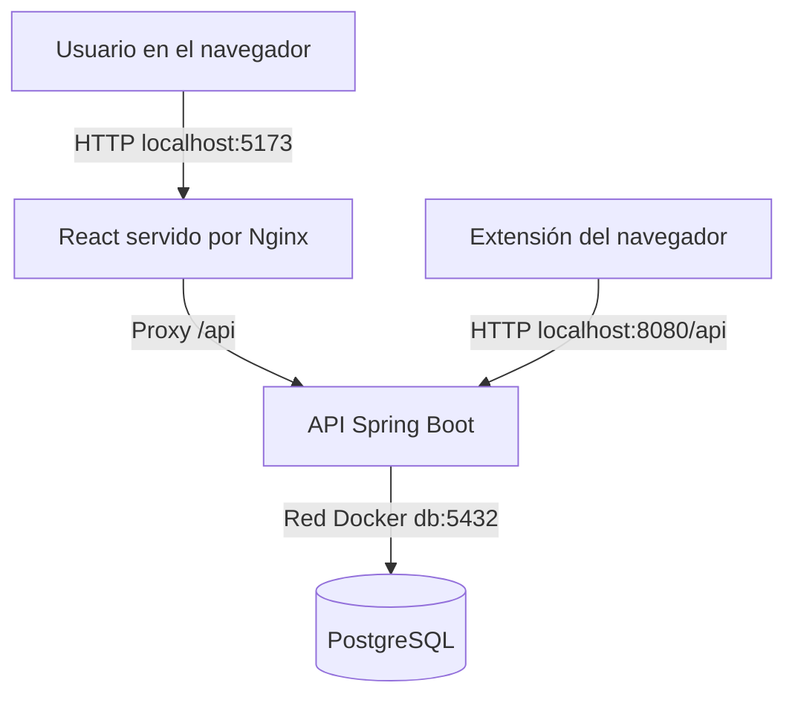

# MarketLens

**Sistema de análisis de riesgo y detección de posibles estafas en marketplaces.**

MarketLens es un prototipo académico que permite registrar y analizar publicaciones de comercio electrónico, observar indicadores de riesgo relacionados con los vendedores y los anuncios, consultar estadísticas y realizar reportes. Incluye una aplicación web, una API REST y una extensión experimental para el navegador.

> **Alcance:** los puntajes son indicadores orientativos basados en la información disponible; **no demuestran que una publicación o un vendedor sean fraudulentos**. La ausencia de datos no equivale a ausencia de riesgo. El proyecto es una demostración académica y no un servicio de verificación comercial.

## Contenido

- [Tecnologías y arquitectura](#tecnologías-y-arquitectura)
- [Requisitos](#requisitos)
- [Inicio rápido en Windows](#inicio-rápido-en-windows)
- [Inicio en Linux o macOS](#inicio-en-linux-o-macos)
- [Acceso y recorrido de demostración](#acceso-y-recorrido-de-demostración)
- [Extensión de navegador](#extensión-de-navegador)
- [Comandos útiles de Docker](#comandos-útiles-de-docker)
- [Desarrollo y pruebas](#desarrollo-y-pruebas)
- [Configuración y seguridad](#configuración-y-seguridad)
- [Problemas frecuentes](#problemas-frecuentes)
- [Estructura del proyecto](#estructura-del-proyecto)

## Tecnologías y arquitectura

| Componente | Tecnologías |
| --- | --- |
| Backend | Java 21, Spring Boot 4, Spring Security, Spring Data JPA, Maven |
| Autenticación | JWT y contraseñas protegidas mediante BCrypt |
| Persistencia | PostgreSQL 17, Flyway (18 migraciones SQL) |
| Frontend | React, TypeScript y Vite |
| Publicación del frontend | Nginx, con proxy de las rutas `/api` |
| Extensión experimental | JavaScript y WebExtensions (Manifest V3) |
| Ejecución reproducible | Docker y Docker Compose |



Los tres servicios (`frontend`, `backend` y `db`) se levantan mediante `compose.yaml`. Los puertos se publican únicamente en la interfaz local (`127.0.0.1`).

## Requisitos

Para usar la demostración **no es necesario instalar Java, Maven, Node.js ni PostgreSQL en el equipo anfitrión**. Se necesita:

- **Docker Desktop** en Windows, con motor Linux/WSL 2 habilitado; o Docker Engine con el complemento Docker Compose en Linux.
- Acceso a Internet durante la primera construcción para obtener las imágenes y dependencias.
- Un navegador moderno.
- Git es opcional si se descarga el código como ZIP en lugar de clonarlo.

Verificá que Docker esté abierto y responda:

```powershell
docker version
docker compose version
```

## Inicio rápido en Windows

Estas instrucciones están pensadas para PowerShell en Windows 10/11 con Docker Desktop.

### 1. Obtener el proyecto

Cloná el repositorio (si tenés permisos de acceso):

```powershell
git clone https://github.com/TomasPuglieseUSAL/marketlens.git
cd marketlens
```

También podés utilizar **GitHub Desktop → File → Clone repository** o descargar un ZIP desde GitHub y abrir una terminal en la carpeta extraída, donde se encuentra `compose.yaml`.

### 2. Crear la configuración local

```powershell
Copy-Item .env.example .env
notepad .env
```

En `.env`, reemplazá el valor de ejemplo de `POSTGRES_PASSWORD` por una **contraseña nueva de desarrollo**. No publiques este archivo ni sus valores.

No necesitás completar manualmente `JWT_SECRET` ni `DEMO_PASSWORD`: el script del siguiente paso las genera y conserva en `.env` si están ausentes o vacías.

### 3. Construir e iniciar MarketLens

Desde la **raíz del proyecto**:

```powershell
powershell.exe -NoProfile -ExecutionPolicy Bypass -File .\scripts\start-compose-demo.ps1
```

El script prepara las claves locales que faltan y ejecuta `docker compose up --build -d`. La primera construcción puede descargar dependencias y tardar más que los arranques posteriores.

> La opción `ExecutionPolicy Bypass` se aplica únicamente al proceso de PowerShell de ese comando. Revisá el script antes de ejecutarlo; no es necesario cambiar permanentemente la política del sistema.

### 4. Comprobar los servicios

```powershell
docker compose ps
```

Deben aparecer `db`, `backend` y `frontend`. La base de datos debería indicar `healthy`.

| Servicio | Dirección desde el equipo anfitrión |
| --- | --- |
| Aplicación web | **http://localhost:5173** |
| API REST | `http://localhost:8080` |
| PostgreSQL | `localhost:5433` (solo conexiones locales) |

Al abrir la raíz de la API sin autenticar es posible recibir `401 Unauthorized`: **es un comportamiento previsto** por Spring Security, no una señal de que el contenedor esté caído.

## Inicio en Linux o macOS

Si disponés de Docker Compose y una terminal compatible con POSIX, podés iniciar la aplicación sin el script de PowerShell:

```bash
git clone https://github.com/TomasPuglieseUSAL/marketlens.git
cd marketlens
cp .env.example .env
```

Editá `.env` y asigná un valor seguro a `POSTGRES_PASSWORD`. También debés agregar **dos líneas** con valores aleatorios (estos comandos generan ejemplos para copiar en el archivo):

```bash
openssl rand -hex 64  # valor para JWT_SECRET
openssl rand -hex 24  # valor para DEMO_PASSWORD
```

El archivo `.env` debe contener al menos:

```dotenv
POSTGRES_PASSWORD=REEMPLAZAR_POR_UNA_CLAVE_LOCAL
JWT_SECRET=REEMPLAZAR_POR_UN_VALOR_ALEATORIO_LARGO
DEMO_PASSWORD=REEMPLAZAR_POR_OTRO_VALOR_ALEATORIO
```

Después ejecutá:

```bash
docker compose up --build -d
docker compose ps
```

**Nota para macOS:** los puertos están limitados a `127.0.0.1`, por lo que el acceso se realiza desde la misma computadora. Este procedimiento no reemplaza una configuración de producción.

## Acceso y recorrido de demostración

1. Abrí **http://localhost:5173**.
2. Iniciá sesión con el usuario **`demo`**.
3. Usá como contraseña el valor de **`DEMO_PASSWORD`** guardado en tu archivo local `.env`. Si utilizaste el script de Windows, lo generó automáticamente.
4. Entrá en **Publicaciones** para consultar las publicaciones identificadas como `[DEMO]`.
5. Elegí una publicación y presioná **Evaluar riesgo**. El motor calcula una evaluación y presenta los factores disponibles.
6. Consultá **Dashboard** para observar las estadísticas actualizadas; también podés explorar **Vendedores**.

El perfil `demo` crea **una cuenta de demostración**, **tres vendedores** y **ocho publicaciones ficticias**. Los datos se identifican como ejemplos y no representan ofertas o personas reales. Las evaluaciones se generan mediante el motor de riesgo cuando se solicitan; no se insertan resultados de evaluación predeterminados.

Las operaciones de inicio de sesión y la API requieren sus respectivas credenciales o un token JWT. Los JWT expiran según la configuración del backend.

## Extensión de navegador

La carpeta [`extension/`](extension/) contiene una extensión **experimental** que permite trabajar con páginas compatibles de Mercado Libre y Facebook Marketplace, a partir de la información visible y los servicios disponibles en el backend.

### Firefox: instalación temporal

1. Con la aplicación Docker encendida, abrí `about:debugging#/runtime/this-firefox`.
2. Seleccioná **Cargar complemento temporal** (*Load Temporary Add-on*).
3. Elegí `extension/manifest.json` dentro de la carpeta descargada del proyecto.
4. Abrí el botón de la extensión e iniciá sesión con la cuenta de demostración.
5. Visitá una publicación compatible y utilizá **Analizar publicación** o las opciones de reporte.

La instalación temporal normalmente se pierde al reiniciar Firefox.

### Chrome / Chromium: carga sin empaquetar

1. Abrí `chrome://extensions`.
2. Activá **Modo desarrollador**.
3. Seleccioná **Cargar descomprimida** (*Load unpacked*).
4. Elegí la carpeta `extension/` (la que contiene `manifest.json`).

> La extensión contiene opciones de manifiesto para distintas familias de navegadores. Su compatibilidad puede variar entre versiones de Firefox y Chromium; si el navegador rechaza el manifiesto o alguna API, esa combinación requerirá una adaptación específica. No se distribuye mediante una tienda de extensiones.

### Limitaciones de la demostración

- La extensión se conecta al backend local mediante **`http://localhost:8080/api`**; no está configurada para un servidor remoto.
- La integración **OAuth de Mercado Libre está deshabilitada** con el perfil `demo`. Las acciones que requieran autorización o validaciones autenticadas contra esa API no estarán disponibles; otras funciones pueden seguir utilizando datos visibles de la página.
- Las integraciones externas opcionales, como Gemini, no están habilitadas en la demostración sin su propia configuración.
- La compatibilidad de extracción depende del formato y de los cambios que realicen los marketplaces en sus páginas.

## Comandos útiles de Docker

Ejecutá estos comandos desde la raíz del repositorio:

```bash
# Ver estado de los tres servicios
docker compose ps

# Consultar los registros del backend
docker compose logs --tail=150 backend

# Seguir los registros en vivo
docker compose logs -f backend

# Reconstruir y arrancar luego de modificar el código
docker compose up --build -d

# Detener los servicios conservando la base de datos
docker compose down
```

PostgreSQL utiliza un **volumen persistente**. `docker compose down` conserva los datos, mientras que **`docker compose down -v` elimina también el volumen** y puede destruir las publicaciones y cuentas guardadas. No lo utilices salvo que quieras reiniciar expresamente una instalación de prueba.

**Importante:** cambiar `POSTGRES_PASSWORD` en `.env` luego de la inicialización no cambia automáticamente la contraseña del usuario dentro de una base que ya existe. Lo mismo sucede con la contraseña `demo` creada en la base: se conserva al reiniciar.

## Desarrollo y pruebas

El modo recomendado para la evaluación es Docker. Si querés trabajar con los componentes por separado:

- **Backend:** Java 21 y el wrapper de Maven incluido en `backend/`.
- **Frontend:** Node.js y npm, usando `frontend/package.json`.

Desde PowerShell en Windows, para ejecutar las pruebas del backend:

```powershell
cd backend
.\mvnw.cmd test
```

Para comprobar la compilación del frontend:

```powershell
cd frontend
npm ci
npm run build
```

> La imagen Docker del backend se construye con `-DskipTests`. Para verificar las pruebas automatizadas, ejecutá Maven por separado como se indica arriba.

Las migraciones de Flyway se encuentran en [`backend/src/main/resources/db/migration/`](backend/src/main/resources/db/migration/) y se aplican sobre una base nueva. El perfil del contenedor utiliza `spring.jpa.hibernate.ddl-auto=validate` para validar el esquema.

## Configuración y seguridad

- **`.env.example`**: plantilla pública de configuración sin secretos reales.
- **`.env`**: configuración local privada (excluida por `.gitignore`).
- **`application-container.properties`**: conexión interna de Spring Boot al servicio Docker `db:5432`.
- **`application-demo.properties`**: usuario y datos de ejemplo; deshabilita OAuth y Gemini en el entorno de demostración.
- **`compose.yaml`**: red, puertos y dependencias de los tres servicios.

No subas `.env`, contraseñas, claves JWT, tokens OAuth ni credenciales de proveedores externos al repositorio. Evitá compartir capturas o registros que contengan estos valores.

La configuración usa **HTTP local** y no incluye las medidas necesarias para exponer la plataforma a Internet. Está destinada al desarrollo, la demostración y la evaluación académica; **no es un despliegue de producción**.

## Problemas frecuentes

| Problema | Qué revisar |
| --- | --- |
| `POSTGRES_PASSWORD` no definido | Crear `.env` a partir de `.env.example` y completar la contraseña. |
| `JWT_SECRET` o `DEMO_PASSWORD` no definido | En Windows, iniciar con `scripts/start-compose-demo.ps1`. En Linux/macOS, incorporarlas manualmente a `.env`. |
| El puerto `8080`, `5173` o `5433` ya está ocupado | Detener otros servidores locales que utilicen ese puerto; comprobar con `docker compose ps`. |
| `docker compose` no responde | Iniciar Docker Desktop y comprobar que use contenedores Linux. |
| `401` al abrir la raíz del backend | Es normal para una ruta protegida sin token; probar el login desde el frontend. |
| No se puede iniciar sesión con `demo` | Consultar `DEMO_PASSWORD` en `.env`, revisar los logs y recordar que una cuenta existente conserva su contraseña original. |
| Falló el backend | Ejecutar `docker compose logs --tail=150 backend`. |
| No funciona la extensión | Confirmar que el backend esté activo en `localhost:8080`, que la sesión esté vigente y que la página sea compatible. |
| OAuth de Mercado Libre devuelve servicio no disponible | Esperable en modo `demo`, porque se encuentra deshabilitado. |

## Estructura del proyecto

```text
marketlens/
├── backend/                # API Spring Boot, seguridad, entidades y migraciones
│   ├── src/main/java/
│   ├── src/main/resources/
│   │   ├── db/migration/   # Flyway: V1 a V18
│   │   └── demo/           # Datos sintéticos
│   ├── src/test/
│   ├── Dockerfile
│   └── pom.xml
├── frontend/               # Aplicación React + TypeScript
│   ├── src/
│   ├── Dockerfile
│   └── nginx.conf
├── extension/              # Extensión experimental de navegador
├── scripts/
│   └── start-compose-demo.ps1
├── compose.yaml
├── .env.example             # Plantilla; sí se versiona
├── .gitignore
└── README.md
```

---

**Estado:** prototipo académico funcional con instalación local reproducible mediante Docker Compose y datos sintéticos para demostración.
